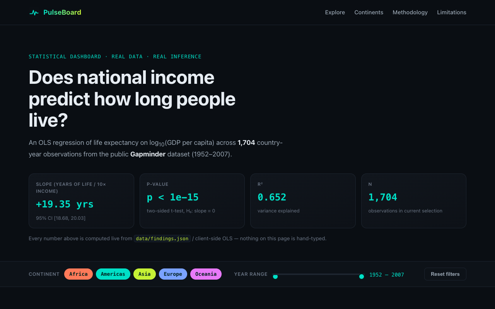

# PulseBoard

**Live demo: https://jeneidi.github.io/pulseboard/**



A reproducible statistics dashboard that asks one question of real public data:

> **Does national income predict how long people live?**

It answers with a real OLS regression — slope, 95% confidence interval, p-value,
R², and n — not a guess, not a fabricated number. Every statistic on the page
is either precomputed by a Python script and read from JSON, or recomputed
live in the browser from the raw rows using a from-scratch JavaScript
implementation of ordinary least squares.

**$0 to run. No API key. No LLM. No backend.** Static HTML/CSS/JS only.

## Headline finding

Ordinary least squares regression of life expectancy on log₁₀(GDP per capita),
full dataset (1952–2007, all continents pooled):

| Statistic | Value |
|---|---|
| Slope | **+19.35** years of life expectancy per 10× increase in GDP per capita |
| 95% CI | **[18.68, 20.03]** |
| p-value | **p < 1e-15** (statsmodels underflows to `0.0`; the true value is astronomically small) |
| R² | **0.652** |
| n | **1,704** country-year observations |

A robustness check controlling for survey year (to rule out "the whole world
got richer and lived longer over time" as the sole explanation) keeps the
slope large and significant: **17.89** years per 10× income, p < 1e-15, R² = 0.717.

Secondary finding — one-way ANOVA of life expectancy across continents:
**F = 408.73, p ≈ 8.3e-247** (extremely strong evidence that mean life
expectancy differs by continent; see the dashboard for per-continent means
and 95% CIs, and pairwise Welch t-tests).

All of the above (plus per-continent means/CIs and pairwise tests) is written
verbatim by `analysis/analyze.py` to `data/findings.json` — the front-end
reads that file, it does not hand-type any number.

## Dataset

- **Name:** Gapminder (five-year country panel: country, continent, year,
  population, life expectancy, GDP per capita)
- **Source URL:** `https://raw.githubusercontent.com/plotly/datasets/master/gapminderDataFiveYear.csv`
- **Downloaded:** 2026-06-24 (UTC)
- **SHA-256:** `714f8a23e9d7429052a1e9b45d20b9adeb64f46c067ed46320e68182e4607b6d`
- **Shape:** 1,704 rows · 142 countries · 5 continents · 12 five-year waves, 1952–2007
- **PII:** none — every row is a country/continent-level aggregate.

`analysis/analyze.py` verifies this checksum against the local raw CSV before
doing anything else, and refuses to run if it doesn't match, so the published
analysis can't silently drift from its stated source.

## Reproduce the analysis

```bash
cd pulseboard
python3 -m venv venv && source venv/bin/activate
pip install -r requirements.txt
python analysis/analyze.py
```

This re-verifies the checksum, re-cleans `data/gapminder_raw.csv`, refits the
models, and rewrites `data/gapminder.json` (cleaned dataset for the front-end)
and `data/findings.json` (every statistic shown on the dashboard) from scratch.

Pinned dependency versions (`requirements.txt`):

```
pandas==2.2.3
numpy==2.1.3
statsmodels==0.14.4
scipy==1.14.1
```

## How the dashboard works

- **Hero stats** come straight from `data/findings.json`, computed once by
  the Python script above.
- **Scatter plot** (`#scatter-chart`): GDP per capita on a log x-axis vs. life
  expectancy, points colored by continent, hand-rolled as SVG (no charting
  library). The yellow-green line is the OLS fit for whatever is currently
  selected.
- **Bar chart** (`#bar-chart`): mean life expectancy per continent with 95%
  CI error bars (t-distribution), also hand-rolled SVG, also recomputed for
  the current filter selection.
- **Filters** (continent multi-select chips + a two-handle year-range
  slider) are genuinely interactive: every change calls `update()` in
  `app.js`, which refits the regression *in the browser* on the filtered
  subset using the closed-form OLS normal equations
  (`β = (XᵗX)⁻¹Xᵗy` for the simple-regression case), derives the slope's
  standard error from the residuals, and computes a t-distribution-based 95%
  CI and two-sided p-value — implemented from scratch in `app.js`
  (`simpleOLS`, `meanCI95`, `oneWayAnovaF`, plus a small incomplete-beta /
  log-gamma routine for the t/F p-values). Nothing is looked up from a
  precomputed table of "filtered" answers; the inference is real for any
  subset you choose, and the displayed n always matches the active selection.
- **Self-check:** on load, `app.js` refits the unfiltered dataset client-side
  and logs the JS slope next to the Python slope to the browser console
  (`[PulseBoard self-check] ...`) — they agree to ~1e-14 (floating-point
  precision), proving the two implementations compute the same statistic.

## Methodology

**Model:** `lifeExp = β₀ + β₁·log₁₀(gdpPercap) + ε`, fit by OLS. Log-income is
used because income is heavily right-skewed and a multiplicative relationship
with lifespan is both standard in development economics and a better fit than
a linear one. A second specification adds a year term as a robustness check
(see `data/findings.json → headline_year_controlled`).

**What the CI and p-value mean:** the 95% CI is the range of slope values that
would contain the true population slope in 95% of repeated samples drawn the
same way, under the model's assumptions. The p-value is the probability of
seeing a slope this extreme if the true slope were zero. With n ≈ 1,700, even
modest effects would be "significant" — the practical magnitude (R² = 0.65,
~19 years of life expectancy per 10× income) is the more important number.

## Limitations

- **Observational, not experimental** — no country was randomly assigned an
  income level; the association is consistent with income causing longer
  life, but also with reverse causation or shared confounders (institutions,
  education, conflict).
- **Country-level aggregation** hides within-country inequality.
- **Five-year sampling** (1952–2007) misses shocks between waves and predates
  the present day — don't extrapolate forward.
- **Continent is a coarse bucket** spanning very different national paths,
  especially within Africa, Asia, and the Americas.
- **Small-sample subsets**: filtering to one continent and a narrow year
  range can leave very few rows; the dashboard always shows the live n so you
  can judge how much to trust a heavily filtered estimate.

## Integrity / security notes

- No `eval()` anywhere in the codebase.
- No `innerHTML` assignment of dynamic or data-derived content — all chart
  geometry and text nodes are built via `document.createElementNS` /
  `createElement` and set via `textContent`/attributes.
- No file upload, no user-submitted code execution, no backend.
- No API keys, no secrets, no `.env` — there is nothing to leak.
- Pinned dependency versions for reproducible analysis (see above).
- Dataset source URL + SHA-256 + download date recorded above and re-verified
  by `analysis/analyze.py` on every run.
- Dataset is country/continent-level aggregate statistics — no PII.

## Files

```
index.html              dashboard markup
styles.css               dark cyan/lime data-viz theme
app.js                    chart rendering + client-side OLS/ANOVA + filters
analysis/analyze.py       the real Python analysis (run during build)
data/gapminder_raw.csv    raw downloaded CSV (checksum-verified input)
data/gapminder.json       cleaned dataset consumed by the front-end
data/findings.json        every precomputed statistic shown on the page
requirements.txt          pinned Python dependencies
LICENSE                   MIT
```

## License

MIT — see [LICENSE](LICENSE).
